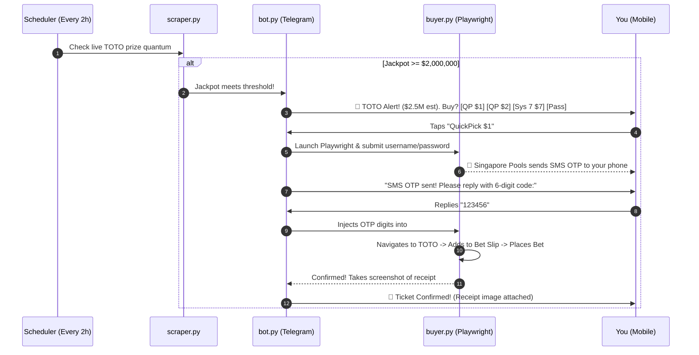

# Singapore Pools TOTO Jackpot Auto-Buyer Bot

An automated assistant that periodically monitors the Singapore Pools TOTO estimated jackpot and lets you purchase QuickPick or System 7 tickets directly via Telegram with human-in-the-loop SMS OTP confirmation.

---

## 🎯 How It Works



---

## 📁 Project Structure

* **scraper.py**: Lightweight scraper that queries Singapore Pools' official static pregenerated file (`toto_next_draw_estimate_en.html`) with zero dependencies and no bot blocking.
* **buyer.py**: Playwright automation engine that handles login, OTP box injection, navigating to TOTO QuickPick, placing bets, and taking receipt screenshots.
* **bot.py**: The Telegram bot engine running `python-telegram-bot` with background scheduler (`JobQueue`) and interactive conversation state machine.
* **history.py**: Purchase tracker and duplicate bet prevention store.
* **settings.py**: Dynamic threshold management.
* **.env.example**: Safe template for your private environment variables.

---

## ⚙️ Configuration (`.env`)

```ini
TELEGRAM_BOT_TOKEN=your_telegram_bot_token_from_botfather
TELEGRAM_CHAT_ID=your_telegram_chat_id
JACKPOT_THRESHOLD=2000000
CHECK_INTERVAL_HOURS=24

SGPOOLS_USERNAME=your_username
SGPOOLS_PASSWORD=your_password

# Set to true for silent background, false for visible window
HEADLESS_MODE=true
```

---

## 🚀 Telegram Commands

* `/check` - Check the current live jackpot immediately.
* `/test`  - Trigger an instant test alert with QuickPick / System 7 buttons.
* `/cancel`- Cancel any pending login / OTP purchase session.
